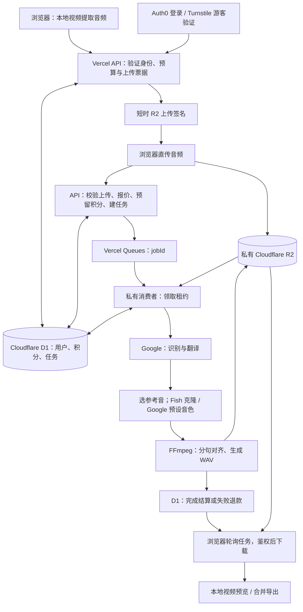

# DubbingNow 项目、上线与复用手册

整理日期：2026-10-28。面向项目所有者和后续开发者；以当前代码、私有生产配置及已有验收记录为依据。本文可以提交源码仓库，真实密钥另存本机私有目录。

## 1. 现在是什么状态

- 正式网站：[dubbingnow.com](https://dubbingnow.com/)，`www.dubbingnow.com` 跳转根域名。
- 源码：[aipjn/dubbingnow](https://github.com/aipjn/dubbingnow)。当前功能与上线工作在 `codex/cloudflare-storage` 分支，最近一次产品代码提交为 `6720b61`。
- 网页、API、后台配音和清理任务已部署在同一个 Vercel 项目。持久业务数据在 Cloudflare D1，音频在私有 R2。
- 当前通过本机 Vercel CLI 发布；项目尚未接通 GitHub 自动部署。`git push` 保存源码，并不自动更新线上。
- 域名、HTTPS、线上页面、能力接口和带密钥的清理接口已有成功记录。正式域名上的真实登录 → 上传 → 队列配音 → 结算 → 关页后再下载，仍需完整验收。
- 本次 10 月 28 日复查：首页、`/v1/ready`、`/v1/capabilities`、`/v1/billing/policy` 均返回 200，单人限制和当前积分策略与下文一致。

这里区分“站点已经上线”和“所有业务已经验收”。后者不能用构建成功、健康检查成功或本地配音成功替代。

## 2. 用到的平台，各自负责什么

| 平台 / 工具              | 本项目用途                                            | 保存或处理什么                                                     | 不承担什么                             |
| ------------------------ | ----------------------------------------------------- | ------------------------------------------------------------------ | -------------------------------------- |
| GitHub                   | 保存代码、提交历史及 CI 配置                          | 源码、无密钥文档、测试和迁移脚本                                   | 不执行本次生产配音，不保存用户音频     |
| Vercel                   | 托管 Next.js 网站、Node API、私有队列消费者、定时清理 | 部署产物、服务端环境变量、函数与构建日志                           | 函数本地磁盘不作为长期数据库或音频仓库 |
| Vercel Queues            | 上传完成后触发后台工作、重投和延迟清理                | 消息仅携带 `jobId`                                                 | 不保存积分账本或音频正文               |
| Cloudflare D1            | 关系数据库                                            | 用户、钱包、流水、试用、上传记录、报价、任务、幂等键、租约、计时等 | 不存大音频文件                         |
| Cloudflare R2            | S3 兼容的私有对象存储                                 | 上传音频、生成 WAV；短期保留                                       | 不代替积分数据库，不提供配音模型       |
| Cloudflare DNS           | 把域名连接到 Vercel                                   | 域名解析和所有权验证记录                                           | 与 R2/D1 是不同职责，当前还在不同账号  |
| Cloudflare Turnstile     | 游客试用的人机验证                                    | 浏览器挑战、服务端验证结果                                         | 不代替用户登录                         |
| Auth0                    | 托管注册、邮箱验证、登录、退出、令牌签发              | 身份与认证会话                                                     | 余额和任务保存在自己的 D1              |
| Google Gemini API        | 音频识别、时间片段、翻译；另有预设音色合成分支        | 音频片段、原文、译文、预设配音                                     | 不负责我们的文件保管、积分或 FFmpeg    |
| Fish Audio API           | 按当前任务参考音进行声音克隆合成                      | 选中的参考音、参考文本、目标译文                                   | 当前生产模式不创建持久保存音色         |
| MediaBunny + AAC encoder | 在浏览器提取音轨、预览及合并视频                      | 用户本机视频与返回音轨                                             | 不负责上传后云端配音的持续运行         |
| FFmpeg / ffprobe         | 服务端音频探测、解码、重采样、变速和时间线对齐        | 可丢弃的工作音频                                                   | 无须自建 GPU 或训练语音模型            |

以上是实际依赖，未接入支付平台。Outlook 仅用于注册收信测试，不是网站邮件发送服务；公开客服邮箱为 `1058134934@qq.com`，运营名称为 DubbingNow。

## 3. 平台如何协作



实际处理顺序：

1. 浏览器读取视频，用 Web Worker 提取音轨并计算文件信息。**原视频不上传**，云端收到的是音频。
2. API 给出签名上传票据。浏览器直传 R2，不让大文件经过 Vercel 普通 API 请求体。
3. 上传完成接口检查对象字节数、哈希、格式与时长。通过后才能报价和创建任务。
4. D1 原子预留积分并保存任务，API 投递队列。成功投递后才返回接受处理；投递失败且任务未领取时取消并退还预留。
5. 私有消费者领取指定任务的租约，从 R2 读音频，调用 Google、Fish 和 FFmpeg。重复消息不会再次领取已结算任务。
6. 结果先写入 R2，再由持有有效租约的消费者结算 D1。失败、超时或取消退还预留，不能重复退款。
7. 下载接口检查身份和有效期，再跳转至短期 R2 签名地址。
8. 用户需要视频时，浏览器把生成音轨与本机原视频合并。刷新或换页面后可能需要重新选择原视频。

上传完成且任务已被后台接受后，云端处理不依赖标签页保持打开。不能在本地抽音频或上传尚未完成时关页并期待后台收到完整文件。当前架构支持独立执行，但正式站关页完整链路仍在待验收列表；没有另做一套用户未要求的任务找回产品。

## 4. 数据放在哪里，什么时候删除

| 内容                               | 位置                                | 保留说明                |
| ---------------------------------- | ----------------------------------- | ----------------------- |
| 用户身份与密码验证                 | Auth0                               | 本站不接收明文登录密码  |
| 用户业务资料、余额、流水和任务状态 | D1 `dubbingnow-db`                  | 与音频过期分开管理      |
| 上传音频                           | R2 `uploads/<uploadId>`             | 按上传/任务过期规则清理 |
| 配音结果                           | R2 `results/<jobId>/<leaseId>.wav`  | 结果下载约 24 小时有效  |
| 解码、分句、对齐中间文件           | 函数 OS 临时目录                    | 任务结束清理，可丢弃    |
| 原视频及本地合并视频               | 用户设备                            | 不上传至本项目后端      |
| API 密钥                           | Vercel 服务端环境变量；本机私有文件 | 不进入网页包或 Git      |

队列在任务结算后安排延迟清理；另有每日 `03:00 UTC`（北京时间 11:00）维护。弃用上传可能到下一次每日清理才删除，不能承诺所有音频在上传后恰好 24 小时物理消失。我们的 R2 删除策略也不等于第三方供应商的数据保留条款。

D1 通过 REST API 访问，R2 通过 AWS S3 SDK 和签名 URL 访问，**本项目没有部署 Cloudflare Worker 作为配音计算服务**。代码里的 `worker` 是 Node 后台处理程序；生产由 Vercel 队列消费者承担这个角色。

## 5. 当前功能和模型配置

当前适合清晰的单人讲解、旁白或口播。最多 1 个说话人；不支持重叠对话。目标语言 12 种：英语、西班牙语、法语、德语、葡萄牙语、意大利语、日语、韩语、中文、印地语、阿拉伯语、荷兰语。

当前策略为：游客一次 30 秒试用；验证后的新账户一次性赠送最多 50 积分；标准 / 高保真分别每分钟 10 / 20 积分，按秒计费，最低 1 积分。音频上限默认 100,000,000 字节、300 秒。最终以 `/v1/billing/policy` 与 `/v1/capabilities` 为准，策略可调整；积分不是美元定价。

不包含口型同步、字幕编辑器、画面文字翻译、背景音乐保留、地区口音选择器。生成配音替换原音轨，原音乐和效果音不会自动保留。支付充值接口目前明确返回未开通。

| 配置                                                  | 当前生产值 / 行为                                    |
| ----------------------------------------------------- | ---------------------------------------------------- |
| `PERSISTENCE_DRIVER`                                  | `cloudflare`                                         |
| `JOB_EXECUTION`                                       | `vercel-queue`                                       |
| `CLONE_PROVIDER`                                      | `fish`                                               |
| `FISH_VOICE_MODE`                                     | `inline`：使用本次源音频中的参考片段                 |
| `FISH_ALLOW_VOICE_CREATION`                           | `false`：不创建保存音色                              |
| `FISH_TTS_MODEL`                                      | `s2.1-pro-free`                                      |
| `GEMINI_TEXT_MODEL`                                   | `gemini-3.8-flash`                                   |
| `GEMINI_TTS_MODEL` / `GEMINI_HIGH_FIDELITY_TTS_MODEL` | `gemini-3.8-flash-lite-tts` / `gemini-3.8-flash-tts` |
| `TEXT_PIPELINE`                                       | 未显式覆盖，代码默认 `combined`，识别翻译合并请求    |
| `SYNTHESIS_CONCURRENCY`                               | 未显式覆盖，代码默认 3 路                            |
| `STREAM_TEXT_PIPELINE`                                | 配为 `true`，但当前 inline 路径不触发提前逐句合成    |
| `MAX_JOB_RUN_SECONDS`                                 | 240，函数上限 300 秒                                 |

这些模型名称是本项目配置快照，不是对供应商长期可用性或价格的保证。价格历史研究见 [当前链路成本](CURRENT_PIPELINE_COST_2026-10-19.md)；其中旧保存音色测试的说明不代表现在的 inline 实现，报价也不是本日账单。

**为什么当前不直接流式提前合成：** `server/dubbing-pipeline.ts` 要求已有保存音色、`singleVoiceTest` 等条件才进入实验流式分支。当前生产会先完成原音分析、参考音筛选和校验，再用本次参考音合成。只打开一个环境开关不会改变这些条件。

**参考句怎么选：** `server/voice-reference.ts` 选择同一说话人的连续完整片段，长度 10–30 秒；拒绝未验证的干净/自然语音、重叠、削波、过长静音或音量异常。依据有效发声比例、接近 20 秒、音量、文字多样性和句尾完整性评分，最多保留每位说话人 3 个不重叠候选，再使用最优候选。没有合格参考时应失败退款，不能偷偷换成固定测试声音。

Fish 账户历史上只有一个保存音色席位。当前 inline 请求不创建新的保存音色；旧 `FISH_REFERENCE_ID` 和 `saved_test` 模式仅是历史调试配置，未带入生产环境变量。不要运行创建、删除、替换模型来“顺手测试”。

## 6. 代码如何组织

技术栈为 Next.js 16.4.3 App Router、React 19.3、TypeScript、Tailwind 4；服务端使用 Node、Zod、jose、S3 SDK 和 Vercel Queue SDK，无自建语音模型。

| 位置                                                              | 作用 / 修改入口                           |
| ----------------------------------------------------------------- | ----------------------------------------- |
| `app/page.tsx`、`app/[tool]/page.tsx`                             | 首页与工具页                              |
| `app/languages/[lang]/[page]/page.tsx`、`lib/language-content.ts` | 语言页路由、各语言正文与 SEO              |
| `components/dubbing-tool.tsx`                                     | 上传、语言/音色选择、状态、预览、下载     |
| `components/account/provider.tsx`                                 | 账户状态、额度与策略                      |
| `lib/local-media*.ts`、`lib/media.ts`                             | 浏览器媒体 Worker、提取与合并             |
| `lib/api/http.ts`、`lib/api/types.ts`                             | 前端 HTTP 协议、幂等请求与类型            |
| `lib/auth0*.ts`、`server/auth.ts`                                 | SPA 会话与后端 JWT / 邮箱验证 / Turnstile |
| `app/v1/[...path]/route.ts`、`server/backend.ts`                  | 同源 `/v1` API 入口、业务校验和分派       |
| `server/persistence.ts`                                           | 选择本地 SQLite 或 Cloudflare D1          |
| `server/store.ts`、`server/cloudflare-store.ts`                   | 用户、积分、任务和原子事务逻辑            |
| `server/cloudflare/d1.ts`、`server/cloudflare/r2.ts`              | Cloudflare REST / S3 适配                 |
| `server/storage.ts`                                               | 上传票据、媒体校验、结果下载鉴权          |
| `server/job-dispatch.ts`、`server/queue-consumer.ts`              | 队列投递、指定任务执行、延迟清理          |
| `app/api/queues/*/route.ts`                                       | 私有队列回调，Node runtime，300 秒上限    |
| `server/processor.ts`                                             | 领取租约、心跳、超时、取消、结果与退款    |
| `server/dubbing-pipeline.ts`                                      | 分块分析、参考音、翻译、并发合成与对齐    |
| `server/providers/google.ts`、`fish.ts`、`index.ts`               | 模型 API 适配和供应商选择                 |
| `server/voice-reference.ts`、`server/media.ts`                    | 参考音评分及 FFmpeg 音频处理              |
| `server/maintenance.ts`、`app/api/maintenance/route.ts`           | 过期清理、租约回收；Cron 密钥保护         |
| `server/config.ts`、`production-check.ts`、`build-config.ts`      | 运行配置、生产前置检查、构建配置一致性    |
| `scripts/build-media-runtime.mjs`、`next.config.ts`               | 编译 FFmpeg、打包到函数、构建标识         |
| `migrations/0001_cloudflare.sql`                                  | D1 建表初始化                             |
| `server/worker.ts`                                                | 本地或独立服务器的常驻处理入口            |
| `tests/`、`.github/workflows/ci.yml`                              | 自动测试、浏览器联调、CI 定义             |
| `docs/openapi.yaml`                                               | API 契约参考                              |

关键实现约束：

- 积分与任务不能改为 JSON 文件。D1 使用原子 batch + 版本约束，冲突整批回滚后重查，防止并发重复扣额。
- 任务租约与结果路径绑定，过期消费者不能覆盖或结算新消费者的结果。
- R2 上传带 `If-None-Match: *`，签名对象不可被同一上传票据覆盖。
- Auth0 JWT 验证 issuer、audience、签名和邮箱状态；身份令牌不当业务余额使用。
- Auth0 SDK 在当前标签页 sessionStorage 缓存会话；localStorage 只放非凭据恢复提示，恢复失败限制重试。
- 服务端密钥不能加 `NEXT_PUBLIC_`。公开配置在构建时注入，改了必须重新 build / deploy。
- 正式同源 API 设置为 `NEXT_PUBLIC_API_BASE_URL=/`；显式空值会启用浏览器演示路径，不能当作正式上线配置。
- 写 Next 代码前先读本仓库 `node_modules/next/dist/docs/` 对应指南，遵守 `AGENTS.md`。

FFmpeg 由构建脚本从官方固定 8.0.3 源码下载、校验 SHA256，并编译最小音频功能。生成文件在忽略目录 `vendor/media/bin`，通过输出追踪打进 API 和消费者；不把 Mac 二进制传到 Linux。构建会做实际解码与对齐自检。

## 7. 已建资源和后台入口

| 项目                     | 当前值                                                                     |
| ------------------------ | -------------------------------------------------------------------------- |
| GitHub 仓库 / 工作分支   | `aipjn/dubbingnow` / `codex/cloudflare-storage`                            |
| Vercel 登录账号 / 工作区 | `aipjn` / `pengais-projects`（Hobby）                                      |
| Vercel 项目              | `dubbingnow`；[项目控制台](https://vercel.com/pengais-projects/dubbingnow) |
| Vercel project ID        | `prj_yeITXWXQMxt3Q6ip8dKgXHbmNgOF`                                         |
| Vercel org ID            | `team_aTLEexTAQEboajLNAssBgNng`                                            |
| Vercel 区域              | `iad1`                                                                     |
| 队列 topic               | `dubbingnow-jobs`、`dubbingnow-cleanup`                                    |
| Cloudflare 存储账号      | `1058134934@qq.com`；[控制台](https://dash.cloudflare.com/)                |
| Cloudflare account ID    | `b298efaeaa5e9f207c34f0566c6e509d`                                         |
| D1 数据库 / ID           | `dubbingnow-db` / `7195762f-45ea-4c11-ad3c-a9dbbb5a5587`                   |
| R2 桶                    | `dubbingnow-audio`，私有                                                   |
| Auth0 tenant / domain    | `dev-f1w6fv0prophuvlx` / `dev-f1w6fv0prophuvlx.us.auth0.com`               |
| Auth0 SPA client ID      | `RxUExtzzVD2jI0fXvMkJ25UuwvSalsNn`（公开标识）                             |
| Auth0 API audience       | `https://dubbingnow.com/api`，RS256                                        |
| Turnstile site key       | `0x4AAAAAAFN88IayvQTmAebr`（公开标识）                                     |

Auth0：[管理后台](https://manage.auth0.com/)。Google：[AI Studio](https://aistudio.google.com/)。Fish：[控制台](https://fish.audio/)。本文不记录个人邮箱登录密码或浏览器会话令牌。

**DNS 在另一个 Cloudflare 账号，由用户在其他电脑管理。** 上述 D1/R2 账号没有域名管理权限；无需把存储迁移到 DNS 账号，也不要用 D1 token 尝试改 DNS。

本次绑定使用过根域 A `216.198.79.1`、www CNAME `18b7e82295823905.vercel-dns-017.com`，另有根域和 www 的 `_vercel` 验证 TXT。域名已通过项目验证；开启 Cloudflare 代理后公网 A 可能显示 Cloudflare 地址。以后重绑必须以 Vercel 当前项目提示为准，这些目标不能直接复制给其他项目。

Auth0 允许根域、www、`localhost:3000`、`127.0.0.1:3000` 的对应回调 `/auth/callback`、退出和 Web Origins；已启用刷新轮换。R2 CORS 允许上述四个 origin 的 `GET, HEAD, PUT` 和规定请求头。换域名时这些位置必须同步更新，临时 Preview 域名不会自动获准。

## 8. 密钥在哪里，哪些能复用

本机已有两份主要私有配置：

- 开发：`/Users/h0270/Documents/ChatGPT/web-vc/.env.local`。
- 已发布生产配置：`/Users/h0270/Documents/ChatGPT/web-vc/.runtime/vercel/production.env`，37 项变量。
- 本次另整理的私有密钥副本：`/Users/h0270/Documents/ChatGPT/web-vc/.runtime/handover/credentials.env`；用途索引为同目录 `credentials-index.json`，说明见 `README.md`。

这些文件由 `.gitignore` 排除；环境文件权限为 `600`。私有副本是本日快照，后续修改 Vercel 配置或轮换密钥后要同步维护，不能把旧副本当永远最新。

| 变量 / 标识                                                       | 用途与权限                       | 复用范围                                                                        |
| ----------------------------------------------------------------- | -------------------------------- | ------------------------------------------------------------------------------- |
| `GEMINI_API_KEY`                                                  | 调用 Google 识别、翻译、预设合成 | 同一服务可复用；新项目使用会共享所属 Google 项目的额度和费用，受原 key 限制约束 |
| `FISH_API_KEY`                                                    | Fish API 合成及账号能力          | 同账号服务可用，共享费用/限制；不代表增加保存音色席位                           |
| `CLOUDFLARE_D1_API_TOKEN`                                         | 当前账户的 D1 读写               | 配合 account/database ID；接入它会访问现有业务数据，不用于无关项目测试          |
| `CLOUDFLARE_R2_ACCESS_KEY_ID` + `CLOUDFLARE_R2_SECRET_ACCESS_KEY` | `dubbingnow-audio` 桶对象读写    | 仅当前授权桶，新增桶不自动获权；二者配套使用                                    |
| `STORAGE_SIGNING_SECRET`                                          | 本站上传/下载票据 HMAC 签名      | 同一项目的所有 API/消费者必须一致；改动会使旧票据失效，不跨站共用               |
| `CRON_SECRET`                                                     | `/api/maintenance` Bearer 鉴权   | 本站维护任务专用，不是模型 API key                                              |
| `TURNSTILE_SECRET_KEY`                                            | 服务端校验浏览器挑战             | 与对应 site key 配套，新增域名需修改 Turnstile 配置                             |
| `NEXT_PUBLIC_TURNSTILE_SITE_KEY`                                  | 浏览器启动 Turnstile             | 公开标识，不是可调用任意 Cloudflare API 的密钥                                  |
| Auth0 domain / client ID / audience                               | 指定租户、SPA 与业务 API         | 公开配置；新增项目要调整应用、回调和权限，不能当管理 API 密钥                   |
| Vercel / GitHub 本机登录                                          | 发布或推代码                     | 现有 CLI / Git 认证继续使用；不从浏览器、系统钥匙串导出进项目                   |
| `VERCEL_OIDC_TOKEN`                                               | CLI 注入的临时身份令牌           | 有效期和作用域有限，不当长期通用 key，不放入私有复用清单                        |
| `FISH_REFERENCE_ID`                                               | 历史保存测试声音 ID              | 非密钥，非每位用户声音；不进入当前生产配置                                      |

复制应用到新项目时，可以复用这套接入代码和配置命名；数据库、桶、签名密钥、Auth0 应用、Turnstile 域名权限应按新项目隔离。复用原 D1/R2 凭据意味着接到现有生产数据，不能直接照搬后运行清理或扣费测试。

## 9. 本地如何开发和调试

工作目录：`/Users/h0270/Documents/ChatGPT/web-vc`。Node 至少 22.16，安装 FFmpeg / ffprobe；按锁文件用 `npm ci`。现有 `.env.local` 含真实服务凭据，**不要用示例覆盖它**。

本地运行有两种方式：

| 模式         | 设置                                                                                                | 用途                                                        |
| ------------ | --------------------------------------------------------------------------------------------------- | ----------------------------------------------------------- |
| 隔离开发     | `PERSISTENCE_DRIVER=local`、`BACKEND_LOCAL=true`、本地 `BACKEND_PUBLIC_URL`、`JOB_EXECUTION=worker` | 本机 SQLite；避免碰生产余额和任务                           |
| 云端存储联调 | `PERSISTENCE_DRIVER=cloudflare`、正确的 `BACKEND_PUBLIC_URL` 与真实凭据、`JOB_EXECUTION=worker`     | 本地 API / worker，共享 D1/R2；可能改真实数据与调用付费 API |

调试本地 API 时 `BACKEND_PUBLIC_URL` 应为实际本机 origin，Auth0 / Turnstile / R2 同时允许该地址。

```bash
# 终端一；确认私有配置中的 origin 和运行模式后执行
npm run dev
# 终端二；读取同一份 .env.local
npm run worker
```

浏览器打开 `http://127.0.0.1:3000`。开发机网络代理只配置在本机，不能上传生产环境。修改服务端变量后重启 API 和 worker；修改 `NEXT_PUBLIC_*` 后生产构建需重做。

```bash
npm run typecheck
npm test
npm run build
```

按需选择联调，避免把测试替身当供应商验收：

| 命令                                          | 验证边界                                                                   |
| --------------------------------------------- | -------------------------------------------------------------------------- |
| `npm test`                                    | SQL / 鉴权 / 原子扣退额 / 适配器等；供应商响应使用替身，不产生真实配音费用 |
| `npm run test:e2e`                            | 按测试配置运行浏览器流程；演示模式不能证明真实 Auth0 或配音成功            |
| `npm run test:cloudflare-live`                | 真实 D1/R2/FFmpeg、并发幂等和下载，配音供应商使用替身                      |
| `npm run test:cloudflare-live -- --providers` | 加真实 Google + Fish；需要本机参考音，产生真实 API 用量；仍不覆盖 Auth0    |
| `npm run test:full-chain`                     | 隔离本地库与预置测试身份的真实配音联调，不覆盖真人 Turnstile / Auth0       |
| `npm run test:auth`                           | 浏览器拦截的 Auth0 SDK 适配测试，不等于真实租户验收                        |
| `npm run preflight -- --require-build`        | 配置、构建一致性、磁盘与 FFmpeg 前置检查；不代表外部平台登录成功           |

`npm run cloudflare:setup` 用于初始化已选中的 D1，执行幂等建表、初始化策略并检查 R2；不是日常启动步骤。`npm run backup` 是本地库备份，不是云端 D1 备份。云端备份需使用 Cloudflare 提供的 D1 导出 / 恢复工具，当前没有声称另建了自动离站备份。

CI 文件定义了 typecheck、test、npm audit、build、Playwright 检查；“有工作流”不代表每次远端检查都已读取确认通过。不同测试不要同时改写 `.next`。本仓库 Next API 和目录约定以随包文档为准。

## 10. 如何发布和回退

当前本机 CLI 已获用户授权并登录，项目关联保存在忽略文件 `.vercel/project.json`。新电脑从仓库恢复时还需完成自己的 CLI 登录、项目关联和私有配置准备。

```bash
git status --short
npm run typecheck
npm test
npm run build
# 审阅并提交本次明确修改的文件，推当前工作分支
git push origin codex/cloudflare-storage
npx --yes vercel@65.1.0 --prod --yes
```

不能用 `git add .` 顺手带上无关改动，也不能把私有配置提交。发布前核对 Vercel 当前项目和账号。当前分支还没有合并 `main`；若后续接 Git 自动发布，要明确生产分支，避免重新部署旧 main。

环境变量已经上传 Vercel production。首次批量上传使用本机脚本 `.runtime/vercel/publish-env.mjs`，读取私有生产文件并通过 stdin 写入，脚本遇已有变量会失败，**不能把它当反复覆盖脚本直接重跑**。日常更新在 Vercel 项目环境变量页或 CLI 中针对变量修改，然后重新部署。公开变量尤其需要重构建；环境变量更新不会追溯改变旧部署。

生产验收至少打开正式域首页，读取 `/v1/ready`、`/v1/capabilities`、`/v1/billing/policy`，再做真实用户业务链路。不要把“ready”当供应商余额、邮件投递或 Turnstile 端到端通过。

队列模式下 `/v1/ready` 可能出现 `worker:false`，它表示没有独立常驻 worker 心跳；此模式不要求该心跳。要结合 `status`、队列触发器和实际任务日志判断，不能只据此认定后台离线。

遇到问题时：

1. 在 Vercel 项目 Deployments 查看构建日志；Functions / Logs 按发生时间和 job ID 查执行错误。
2. 对照 D1 任务状态、租约、积分流水和 `pipeline_metrics`，确认是上传、队列、供应商、对齐还是结算阶段。
3. 检查 R2 是否有对应上传/结果对象，下载是否仍在有效期内。不要手改余额来掩盖失败。
4. 必要时配置 `PAUSE_NEW_JOBS=true` 并重新部署暂停新增任务，再处理故障。
5. 代码回退可在 Vercel 选已知可用部署执行回退；配置、数据库与数据不是随代码自动回滚。应核对迁移兼容性，避免恢复旧代码后破坏已有任务。

本次已解决的具体问题：

| 问题                                  | 修复 / 排查方法                                                    |
| ------------------------------------- | ------------------------------------------------------------------ |
| Vercel 上 SQLite / 本地结果不能持久化 | 改 D1/R2，函数磁盘只保留中间文件                                   |
| 直接启动 Next 不会启动常驻 worker     | 增加 Vercel 私有队列，上传后独立触发消费                           |
| Linux 缺少正确 FFmpeg                 | 构建阶段固定源码编译、打包追踪、实际解码自检                       |
| D1 并发条件检查可能与扣额脱节         | 原子 batch + 版本保护、竞争回滚测试                                |
| Auth0 刷新掉会话或恢复循环            | sessionStorage 缓存、刷新轮换、退出清理、一次恢复限制              |
| 下载只弹错未保存                      | 校正真实下载链路，实际保存 WAV 并用 ffprobe 核验                   |
| Vercel Hobby 拒绝提交作者部署         | 仓库本地提交邮箱设置为已验证账号 `1058134934@qq.com`；不改全局历史 |
| Vercel 域名命令报无权限               | 核对项目域名绑定/验证状态；DNS 由另一个账号的用户手动处理          |
| Tools 菜单图标差、外部点击不收起      | 更新图标，加入外部点击 / Esc / 导航关闭处理                        |
| 页面承诺多人、正文却限单人            | 统一单人能力文案；西语/葡语/印地语增加专属 SEO 内容                |
| 内部固定测试音色细节出现在公开页      | 清理公开文案；遗留测试模式不冒充用户自己的声音克隆                 |

运行环境还有一项记录：`package.json` 是 `node >=22.16.0`，并未锁定主版本；曾观察 Vercel 实际选择 24.x。CI 是 Node 22。以后处理运行时兼容问题，要查看实际构建版本，不能假定线上必然为 22。

## 11. 实测结果与仍需补的验收

| 检查                   | 已有证据                                                                    | 边界                                               |
| ---------------------- | --------------------------------------------------------------------------- | -------------------------------------------------- |
| 自动测试               | 10 月 25 日 75 项通过；10 月 27 日文案更新后 typecheck / build 通过         | 本次文档整理不重跑付费配音或整套浏览器测试         |
| 真实 D1/R2             | batch 回滚、并发任务只扣一次、覆盖上传返回 412、清空本地目录仍可下载        | 云端存储测试不等于线上队列闭环                     |
| Google + Fish + FFmpeg | 17.086542 秒输入/输出；10 月 25 日新运行时管线约 39.421 秒                  | 本地执行器访问真实云服务，不是正式站点击到下载时间 |
| 同轮分阶段时间         | Google 约 10.657 秒，Fish 最慢请求约 21.35 秒；整套脚本约 73.110 秒         | 脚本总时长包括准备、上传、数据库断言、下载和清理   |
| 真实 Auth0 账户配音    | 此前本地网页管线 32.081 秒，创建到完成 34.111 秒；50 积分变 47              | 不含上传前处理，不等于新生产队列耗时               |
| Auth0 会话             | 本地真实 Google 登录、刷新、退出重登；邮箱账户验证和下载通过                | 正式域名仍需重复验收                               |
| 新注册 OTP             | 自动邮件到达，验证码接受并进入设置密码页                                    | 尚未完成该新流程的最终新密码提交                   |
| 线上部署               | Linux FFmpeg 构建自检、首页/接口响应、私有消费者访问隔离、真实维护清理通过  | 不证明所有外部账户功能均成功                       |
| 域名和公开文案         | 根域 / www 已验证；10 月 27 日 26 个可索引页面 HTTP 200，无内部临时文案命中 | 不等于搜索引擎排名或收录保证                       |

本机证据：`.runtime/vercel/live-provider-smoke.json`、`.runtime/auth0/real-account-pipeline.json`、`.runtime/vercel/maintenance-smoke.log`、`.runtime/vercel/public-copy-live-audit.json`、`.runtime/vercel/public-copy-deploy.log`。这些是私有调试资料，不作为网站静态资源发布。

剩余工作优先级：

1. 在正式域名上验收真实注册/登录、游客 Turnstile、上传、私有队列、关页继续执行、积分和下载；实际测量上传前处理、队列等待与处理总时间。
2. Auth0 仍使用内置测试邮件服务与 Google 开发密钥；配置自己的正式邮件发送服务和 Google OAuth 凭据，补完新注册流程。
3. 测长音频和接近 300 秒上限的输入。240 秒处理期限不保证任意 5 分钟音频都能完成；超时应退款。进程崩溃依赖过期租约恢复和退款，不支持从半句合成处续跑。
4. 确定实际充值方案后再接支付；目前没有收款。监控通知、云端导出备份与预算告警需按实际配置验收，不能只因为有脚本就算已运维。
5. 其余 9 个语言页再逐步增加独有内容，避免模板堆词。先做的西语、葡语、印地语已有专门内容。

## 12. 下个项目可以复用什么

最值得复用的是“轻前端 + API + 持久队列 + 数据库 + 私有对象存储”的结构，以及 Auth0 接入、签名直传、幂等扣退额、任务租约、供应商适配器、FFmpeg 构建和联调记录方式。它们不限定在配音产品。

复用步骤：复制代码骨架 → 建自己的 Vercel 项目 → 建自己的 D1/R2 → 初始化数据库 → 配 Auth0 和 Turnstile 域名 → 填服务密钥 → 配队列与清理 → 构建发布 → 正式域名真实业务验收。模型 API 可以按账号权限复用，但要清楚费用和限额归属。

内部实现细节放在本手册和开发文档。公开产品页只讲用户实际能使用的能力、必要限制、费用与数据处理事实，不把固定测试音色、联调模式或部署细节写成产品卖点。

继续阅读：[部署说明](VERCEL_DEPLOYMENT.md)、[Cloudflare 存储](CLOUDFLARE_STORAGE.md)、[功能验收状态](FUNCTIONAL_STATUS.md)、[API 契约](openapi.yaml)。历史调研与测试文档按各自日期理解，当前架构和验收边界以本手册为入口。
